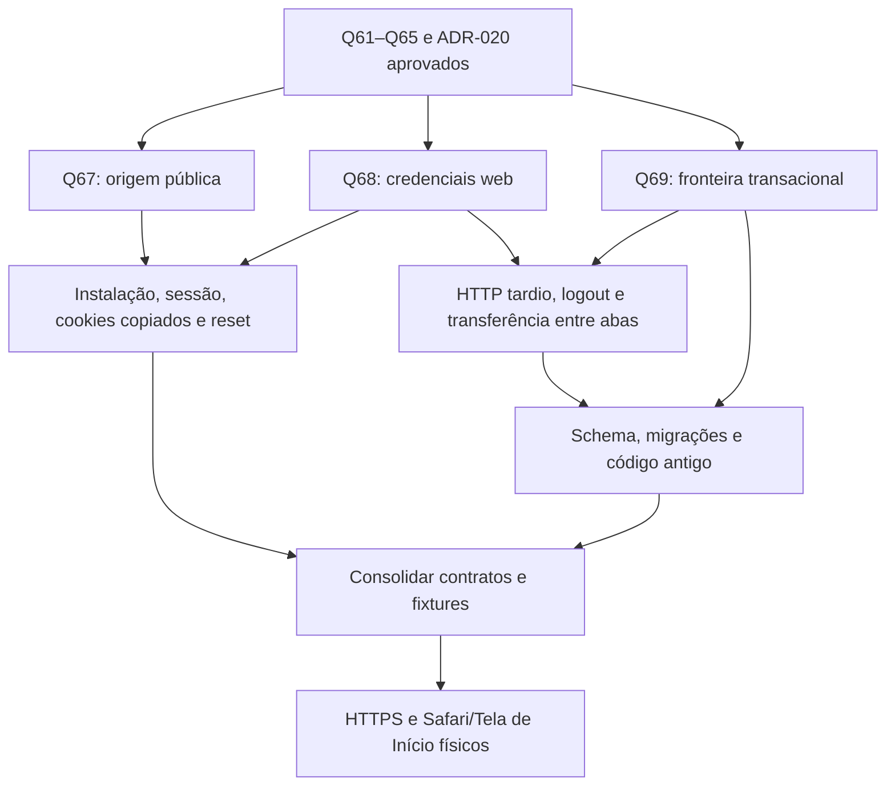

# Entrevista — contratos da PWA

Fonte: spec/14 e tarefa02. Método grilling: decisões por dependência; fatos apurados no código/fontes oficiais. Recomendações só viram contrato depois da resposta e consolidação. Não implementar os ramos pendentes.

## Decisões anteriores

Q61–Q65 aprovadas em [spec/14](../../specs/14-pwa-primeiro-marco.md): M1 funcional adicional; Safari/Tela de Início; durabilidade web com risco explícito; uma aba escritora; aceite funcional PWA+iPhone/Android. ADR-020 escolhe React DOM/Vite/Router+Dexie+Workbox. Prova01 local concluída em `b8c8e46`, sem aceite Safari.

## Fato informado — Q66, 21/10/2026

Pedro informou **iOS26.6.2** instalado no iPhone16e. Não é resultado de teste físico nem confirmação da versão exata do Safari/WebKit. Origem HTTPS de teste e nome do domínio seguem pendentes conforme Q54; nenhuma compra/publicação solicitada.

## Rodada1 — fronteira atual

Proposta concreta, opções e diagnóstico: [contratos rodada1](../../docs/analises/2026-10-21-contratos-pwa-rodada-1.md).

- **Q67 — Origem pública:** A, mesmo endereço HTTPS para frontend estático+API Java, recomendada; B, origens distintas com CORS/credenciais. **Aguardando resposta.** Não define nome/DNS nem autoriza deploy.
- **Q68 — Credenciais web:** A, credenciais HttpOnly/Secure fora do JS, recomendada; B, access só em memória JS com refresh protegido por cookie. **Aguardando resposta.** Nativo permanece bearer e não muda TTL nesta rodada.
- **Q69 — Banco transacional:** A, controle+domínio no mesmo IndexedDB por instalação com partição obrigatória por conta e preferências separadas, recomendada; B, bases de domínio separadas por conta com outro protocolo de coordenação. **Aguardando resposta.** Não promover a prova a schema de produto.

## Árvore e próxima fronteira

Raízes Q67/Q68/Q69 são independentes. Após respostas: instalação/cookie copiado e reentrada; login/refresh/revogação com resposta perdida e HTTP tardio; separação posse/geração; migração/upgrades/conexões antigas; interação com formulários/recarga; reset e parâmetros de HTTPS; prova física/métricas. Recalcular a fronteira após a rodada, sem presumir respostas dependentes.

Garantias que não serão reperguntadas: ADR-016, Q51–Q53, Q56–Q58, Q61–Q65, domínio/XP/idempotência/dia lógico. Configuração operacional ainda depende dos gates existentes; fase M1 continua aberta.
