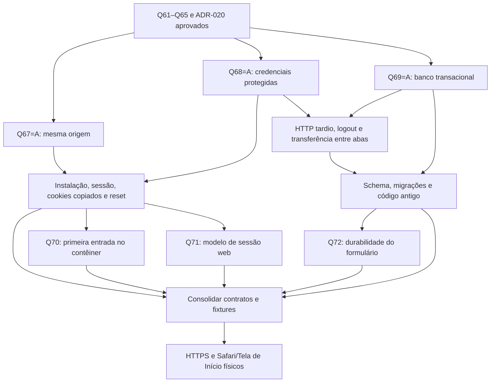

# Entrevista — contratos da PWA

Fonte: spec/14 e tarefa02. Método grilling: decisões por dependência; fatos apurados no código/fontes oficiais. Recomendações só viram contrato depois da resposta e consolidação. Não implementar os ramos pendentes.

## Decisões anteriores

Q61–Q65 aprovadas em [spec/14](../../specs/14-pwa-primeiro-marco.md): M1 funcional adicional; Safari/Tela de Início; durabilidade web com risco explícito; uma aba escritora; aceite funcional PWA+iPhone/Android. ADR-020 escolhe React DOM/Vite/Router+Dexie+Workbox. Prova01 local concluída em `b8c8e46`, sem aceite Safari.

## Fato informado — Q66, 21/10/2026

Pedro informou **iOS26.6.2** instalado no iPhone16e. Não é resultado de teste físico nem confirmação da versão exata do Safari/WebKit. Origem HTTPS de teste e nome do domínio seguem pendentes conforme Q54; nenhuma compra/publicação solicitada.

## Rodada1 — respondida em 21/10/2026

Proposta concreta, opções e diagnóstico: [contratos rodada1](../../docs/analises/2026-10-21-contratos-pwa-rodada-1.md).

- **Q67 — Origem pública:** A, mesmo endereço HTTPS para frontend estático+API Java, recomendada; B, origens distintas com CORS/credenciais. **Pedro respondeu A.** Não define nome/DNS nem autoriza deploy.
- **Q68 — Credenciais web:** A, credenciais HttpOnly/Secure fora do JS, recomendada; B, access só em memória JS com refresh protegido por cookie. **Pedro respondeu A.** Nativo permanece bearer e não muda TTL nesta rodada.
- **Q69 — Banco transacional:** A, controle+domínio no mesmo IndexedDB por instalação com partição obrigatória por conta e preferências separadas, recomendada; B, bases de domínio separadas por conta com outro protocolo de coordenação. **Pedro respondeu A.** Não promover a prova a schema de produto.

## Árvore de decisões

As três raízes Q67/Q68/Q69 foram aprovadas em A e consolidadas no [ADR-021](../../docs/adr/0021-fronteira-de-sessao-e-armazenamento-web.md). A próxima fronteira tem Q70/Q71/Q72 abaixo; não presumir respostas dependentes.

Garantias que não serão reperguntadas: ADR-016, Q51–Q53, Q56–Q58, Q61–Q65, domínio/XP/idempotência/dia lógico. Configuração operacional ainda depende dos gates existentes; fase M1 continua aberta.

## Rodada2 — fronteira atual

Proposta concreta: [rodada2](../../docs/analises/2026-10-21-contratos-pwa-rodada-2.md).

- **Q70 — Contêiner novo:** A, autenticação online explícita e sessão própria, recomendada; B, transferência autenticada específica. **Aguardando resposta.** Não apagar controle ilegível nem recuperar intenções ainda locais do Safari como se já estivessem no servidor.
- **Q71 — Modelo de sessão web:** A, sessão opaca controlada no Java/PostgreSQL, recomendada; B, ciclo nativo em cookies segregados por sessão/tentativa. **Aguardando resposta.** Q68 não escolheu esse modelo; ambas precisam proteger respostas tardias.
- **Q72 — Formulário não salvo:** A, rascunho só na aba com recarga adiada e confirmação de descarte deliberado, recomendada; B, recuperação durável por conta. **Aguardando resposta.** Intenções já salvas e isolamento pós logout mantêm suas garantias anteriores.

Próximos ramos dependem dessa rodada: protocolo exato de sessão, validade/renovação, cookies/CSRF e revogação; campos/stores/migrações e posse distinta da geração; atualização e recuperação; prova física. Não pedir novamente aprovação para logout offline, leitura da mesma sessão ativa ou invalidar conteúdo antigo após troca: já estão definidos.
