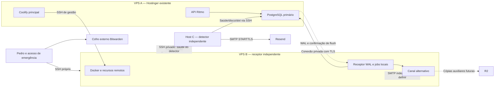

# Segunda VPS gerenciada pelo Coolify — guia de configuração

Data: 03/10/2026. Estado: documentação/proposta; configuração remota não executada. Origem: pedido de Pedro, [recorte 4](../../.scratch/recuperacao-operacional/issues/04-validar-operacao-externa.md), [ADR-019](../../docs/adr/0019-recuperacao-operacional-sem-perda-de-confirmacoes.md) e REQ-NFR-004. Fontes detalhadas: [pesquisa](../../docs/analises/2026-10-03-referencias-coolify-multiplos-servidores.md).

## 1. O que será configurado

Sim: o Coolify existente pode cadastrar uma VPS de outro fornecedor por SSH. O painel coordena operações; Docker na VPS escolhida executa os recursos. Não é necessário instalar outro painel Coolify em B. Os dados permanecem no servidor de destino. [Modelo oficial](https://coolify.io/docs/core/how-coolify-works).

Cadastrar um servidor para recursos específicos não replica a API, não cria failover do PostgreSQL nem transfere recursos existentes. A funcionalidade de replicar uma mesma aplicação em múltiplos servidores é distinta e desnecessária neste recorte. [Multi-server deployments](https://coolify.io/docs/core/infrastructure/scaling/multi-server-deployments).

Q44 declarou Hostinger/Campinas, Ubuntu 24.04 e Coolify 4.3.23; a instalação não foi acessada. Menus abaixo seguem a documentação vigente e precisam ser conferidos na versão instalada. Não há atualização do painel prevista neste guia. HostGator permanece candidata: SO, região e capacidade útil exigem confirmação conforme a [análise](../../docs/analises/2026-10-02-analise-hostgator.md).

## 2. Topologia proposta

A/B/C são papéis, não IDs de fornecedores. O receptor guarda WAL/base sem um segundo PostgreSQL completo em replay contínuo. Detector fica em outro host, separado de A/B; R2 permanece auxiliar. [Contrato de topologia](external-provisioning.md), [WAL](wal-recovery.md).

Recomendo como proposta inicial uma configuração híbrida: B cadastrado no Coolify para recursos Docker, com receptor/agenda/recuperação críticos supervisionados localmente em B e acesso administrativo direto. Serviços nativos não aparecem como recursos Docker com deploy por clique. O supervisor e a [agenda nativa](linux-scheduling.md) foram implementados e ensaiados localmente em 4B; [transporte SSH e watchdog recíproco](probe-transport.md) também foram verificados localmente; [proxy/TLS e origem confiável](proxy-activation.md) e [telemetria primária](primary-telemetry.md) têm pacote/prova locais; instalação e aceite externo ainda estão pendentes.

Uma alternativa é empacotar o receptor como recurso Compose gerenciado pelo Coolify. Exige imagem própria testada, mounts persistentes, identificação do processo e bloqueio de restart/redeploy durante freeze. Esse pacote ainda não existe no repositório; template de banco não o substitui. O incremento local de supervisão adotou o serviço nativo. Esta alternativa Compose não foi implementada; fornecedor/cadastro/instalação externos continuam a definir.

## 3. Preparação e chaves

Registrar SO/arquitetura, fornecedor/região, disco útil, console de recuperação e endereço de gestão. Para o Ritmo, confirmar Python 3.11+, IANA tzdata, clientes PG18, coreutils e filesystem durável. Não aplicar automaticamente instruções de Oracle ARM gratuito à imagem HostGator NVMe. [Pré-requisitos](operations.md), [provedor](../../docs/analises/2026-10-02-analise-hostgator.md).

Usar uma VPS nova: a validação pode instalar Docker e reiniciar o daemon, afetando containers existentes. [Add Server](https://coolify.io/docs/core/infrastructure/servers/add-server).

Preparar chave exclusiva para Coolify A→B e outra chave administrativa de Pedro para acessar B após perda de A. Guardar recuperação no canal privado/cofre, sem valores neste guia/Git/chat. Confirmar fingerprint SSH pelo console/fonte confiável; não desabilitar sua verificação. [OpenSSH](https://coolify.io/docs/core/infrastructure/servers/openssh).

O fluxo oficial usa root com chave. A opção de usuário dedicado sem root é experimental e exige sudo sem senha; mantém poder administrativo. Ela não isola B de um painel comprometido. A conta de gestão é distinta do usuário operacional do receiver. [Non-root user](https://coolify.io/docs/core/infrastructure/servers/non-root-user).

## 4. Cadastro no Coolify existente

1. Em **Keys & Tokens → Private Keys → Add**, gerar ED25519 exclusiva, por exemplo `ritmo-receptor-gestao`, sem passphrase interativa.
2. Pelo acesso inicial a B, acrescentar a chave pública ao `authorized_keys` da conta escolhida, preservando entradas existentes. Diretório SSH 0700, arquivo 0600 e dono correto.
3. Em **Servers → Add → Manual**, preencher a tabela e continuar.
4. Executar **Validate Server & Install Docker Engine** ou **Validate Server**; confirmar alcançável/validado e resultado Docker/Compose/proxy.

| Campo | Valor proposto |
|---|---|
| Name | `ritmo-receptor` |
| Description | Receptor independente; persistência e acesso de emergência próprio |
| IP Address/Domain | Endereço alcançável de B, sem HTTP/HTTPS |
| Port | Porta SSH real, usualmente 22 |
| User | Conta administrativa preparada para Coolify |
| Private Key | Chave cuja pública foi autorizada em B |
| Use it as a build server? | Desligado: B será destino de execução |

Nomes são sugestões locais. Validação prepara o servidor, sem provar backup/durabilidade/RTO. [Passos oficiais](https://coolify.io/docs/core/infrastructure/servers/add-server).

## 5. Rede, portas e proxy

Redes Docker são locais: cadastrar B não une a rede `coolify` dos hosts nem cria VPN. O nome Compose de um serviço em A não se torna acessível automaticamente em B. Preparar a rede privada criptografada prevista no caderno; tecnologia/endereços ainda serão definidos. [Redes](https://coolify.io/docs/core/networking-in-coolify).

| Caminho | Permissão neste cenário |
|---|---|
| A → B | SSH, restrito à origem administrativa do Coolify |
| Pedro → B | SSH próprio por origem autorizada/VPN, além do console |
| B → A | PostgreSQL privado, geralmente 5432, HBA restrito e TLS `verify-full` |
| Detector C → B | Probe autenticado/restrito com timeout, ainda a implementar |
| B → serviços necessários | Saída DNS/horário/repositórios/registry utilizado |
| C → Resend | STARTTLS com certificado validado; porta/entrega a testar |

Não abrir 8000/6001/6002 em B: pertencem à instância/painel. Abrir 80/443 somente se B servir HTTP público. Não publicar PostgreSQL na internet nem entrada de rede no receiver: `pg_receivewal` inicia a conexão ao primário. [Firewall](https://coolify.io/docs/core/infrastructure/servers/firewall), [pg_receivewal](https://www.postgresql.org/docs/18/app-pgreceivewal.html).

A validação pode iniciar o proxy. Se B for dedicado ao receptor, usar **Servers → B → Proxy → Custom (None)** conforme a versão, confirmar proxy parado e manter portas web fechadas. Receiver não precisa de domínio público. Se B depois servir HTTP, configurar domínio/DNS/proxy/TLS nele antes da exposição. Não alterar o proxy de A para cadastrar B. [Proxy](https://coolify.io/docs/core/networking/proxy/overview).

Usar firewall do fornecedor quando disponível, conferir IPv4/IPv6 e testar exposição de fora. Mapeamentos Docker podem interferir na proteção observada; não confiar apenas na lista UFW. Preservar acesso de console durante ajustes. [Firewall Coolify](https://coolify.io/docs/core/infrastructure/servers/firewall), [Docker e firewalls](https://docs.docker.com/engine/network/packet-filtering-firewalls/).

## 6. Lançamento e persistência dos recursos

No projeto/ambiente Ritmo, usar **New Resource**, selecionar fonte/tipo e destino **ritmo-receptor**, conforme o formulário da versão. Conferir B antes de salvar/deploy; cadastrar B não move os recursos de A. Git remoto/registry/credenciais de leitura ainda serão definidos. [Compose](https://coolify.io/docs/applications/builds/docker-compose).

Para recurso comum, configurar imagem/versão, comando, variáveis de runtime, limites e storage. Se usar Compose, revisar arquivo e definição gerada. Para HTTP em B, DNS aponta para B e o proxy de B atende; o tráfego não atravessa o painel de A. [Networking](https://coolify.io/docs/core/networking-in-coolify).

Para operação, reservar `/srv/ritmo-backup` em B, com dono/permissões do pacote testado, separado dos diretórios de build. Contém bases/dumps/WAL/catálogo/eventos/pacotes congelados definidos em [operations.md](operations.md). Bind mount usa o disco de B; não cria cópia nem storage compartilhado. Em Compose, o arquivo define os mounts. [Bind mounts](https://coolify.io/docs/core/persistent-storage/storage-mounts/bind-mounts).

Conferir persistência/UID/GID após troca de container e reboot. Credenciais em caminho privado do host, montadas apenas no processo necessário, nunca em imagem/Git/build-arg. Arquivos em `/run` precisam ser reprovisionados com segurança após reboot antes da inicialização. [Persistência](https://coolify.io/docs/applications/configuration/persistent-storage), [custódia](operations.md).

Evitar builds pesados na VPS do receptor. Durante congelamento, bloquear deploy automático/preview e escrita concorrente no mesmo diretório. Limpeza de volumes/exclusão de recurso ou servidor/rebuild não é expurgo de backup. Revisar os efeitos da ação na versão antes de usá-la. Cadeia segue expurgo por dependência. [Remove Server](https://coolify.io/docs/core/infrastructure/servers/remove-server), [retenção](operations.md).

## 7. Supervisão e agenda independentes

Receiver é processo contínuo, não tarefa cron. Precisa reconectar com mesmo slot/diretório, preservar `.partial`/`.history` e emitir estado verificado. Antes de freeze, parar e inibir reinício, inclusive por reboot, start manual e redeploy. Stop no painel sozinho não prova o contrato. O [supervisor nativo](receiver-supervision.md) foi verificado localmente; a instalação e o aceite desse processo na VPS seguem em 4C/4D. [WAL](wal-recovery.md), [CLI](operations.md).

Na proposta nativa, serviço e timer/cron residem em B e são operáveis por SSH próprio. Na alternativa Docker, restart é aplicado localmente: `unless-stopped` preserva parada manual após restart do daemon, mas não impede recriação por Compose/Coolify. Não usar dois supervisores concorrentes para iniciar o mesmo container. Política/bloqueio de deploy precisam de prova. No código público da tag v4.3.23, StartService recria os containers; uma parada prévia não inibe esse caminho. [StartService v4.3.23](https://github.com/coollabsio/coolify/blob/v4.3.23/app/Actions/Service/StartService.php), [Restart Docker](https://docs.docker.com/engine/containers/start-containers-automatically/).

Executar `tick` localmente pelo menos a cada minuto: ele resolve 03:00 America/Sao_Paulo, horário perdido e execução incerta. Não duplicar agenda no painel. `monitor`, agenda e estado residem no detector C. [Jobs existentes](operations.md).

Scheduled Tasks do Coolify executam comandos em containers, mas dependem da coordenação do painel. Não usar como única agenda dos backups/alertas que devem sobreviver à perda de A. Backup de banco do painel é adicional; não substitui base física/WAL/expurgo Ritmo. [Scheduled Tasks](https://coolify.io/docs/core/automation/scheduled-tasks/overview), [backups de bancos](https://coolify.io/docs/databases/backups).

## 8. Falhas e recuperação da gestão

| Situação | Consequência / ação |
|---|---|
| Painel indisponível, hosts saudáveis | Containers existentes podem continuar; gestão/jobs coordenados pelo painel indisponíveis; usar acesso direto |
| VPS A perdida | API/PG/Coolify de A indisponíveis; acessar B/C independentemente e seguir reconstrução isolada |
| SSH A→B falha | Painel perde gestão; isso sozinho não encerra containers. Corrigir conexão sem apagar/recriar recurso |
| Receiver/disco B falha | Preservar cadeia; não reduzir sincronismo. API pode recusar confirmação; detector alerta |
| B reinicia | Retornar mounts/segredos/serviços na ordem testada; se congelado, manter receiver inibido |
| Painel/chave administrativa comprometido | Gestão tem poder sobre B; separação de host/disco não prova proteção contra ataque às duas VPS |

Continuidade remota depende de host/runtime/rede saudáveis e não equivale a failover. O cenário Q33 é perda da VPS primária, não uma garantia contra comprometimento administrativo compartilhado. [Continuidade Coolify](https://coolify.io/docs/core/how-coolify-works), [escopo aceito](../../docs/adr/0019-recuperacao-operacional-sem-perda-de-confirmacoes.md).

Preparar cópia externa do backup da instância e guardar separadamente `APP_KEY`, necessária para ler seus segredos criptografados. Backup do painel não inclui dados/volumes Ritmo. Bitwarden é o cofre escolhido para chaves; arquivos grandes exigem destino privado adequado, sem presumir anexos pagos na conta Free. R2 é candidato, com acesso/permissões/restore pendentes. [Instance backup](https://coolify.io/docs/core/backup-and-recovery/instance-backup).

Para reconstruir gestão, preservar também `/data/coolify/ssh/keys/`, autorizações SSH necessárias e versão/configuração. Seguir restore oficial com backup/APP_KEY correspondentes, sem copiar indiscriminadamente `.env` antigo sobre instalação nova. Restaurar isoladamente e revisar filas/automação/destinos antes de reconectar B, evitando start durante freeze. Restaurar painel não pode ser pré-requisito para acessar a cadeia/restaurar Ritmo. [Instance restore](https://coolify.io/docs/core/backup-and-recovery/instance-restore).

## 9. Checklist de aceite externo

- [ ] Versão/SO/arquitetura, Docker/Compose e capacidade útil reais; proposta/custos confirmados antes de contratar.
- [ ] B validado no painel e SSH de Pedro testado com A indisponível; console/fingerprint/cofre acessíveis.
- [ ] Ausência de painel/PG público em B, firewall externo, rede privada/TLS e destino dos recursos corretos.
- [ ] Storage/permissões preservados após troca de container/reboot, sem dois receivers.
- [ ] Receptor/agenda sem painel; processo correto e parada/inibição contra restart/redeploy/reboot durante freeze.
- [ ] Probe/alertas/estado no detector separado; perda A/B e falha de canal/agenda do detector exercitadas.
- [ ] Gestão restaurada com backup/APP_KEY/chaves em ambiente isolado, sem sobrescrever receptor existente.
- [ ] Cadeia/PITR, perda de primário de ensaio, recuperação integral e RTO comprovados conforme [matriz](external-provisioning.md).

Este guia não aceita os gates externos. O [supervisor nativo](receiver-supervision.md) foi implementado e ensaiado localmente em 4B; agenda, transporte/watchdog, proxy/TLS e telemetria primária também têm pacote/prova locais. A próxima etapa operacional é definição/dimensionamento e instalação/aceite isolados em 4C/4D. Cadastro e execução remotos ficam para provisionamento; protótipo e decisão comercial continuam independentes.

## 10. Verificação deste incremento documental

App typecheck/lint/test aprovados (exit 0), 94/94 sem ignorados. API: Java 21, `gradlew.bat -p api check --no-daemon` aprovado em 16 s; operationsTest executou 8/8, suíte Java permaneceu UP-TO-DATE. Nenhum teste novo para esta mudança só de documentação. Não houve acesso a VPS/painel, geração de credencial, instalação, alteração de firewall, contratação, deploy nem teste de recuperação externa. Checklist acima permanece pendente.

03/10/2026 — pacote local de supervisão: [receiver-supervision.md](receiver-supervision.md) implementa o serviço nativo fora do ciclo Compose/Coolify e seu protocolo de Stop/inibição/retomada/congelamento. [Ensaios locais](../../docs/analises/2026-10-03-supervisao-do-receptor-wal.md) não aceitam instalação/agenda externa, capacidade, independência física ou RTO. Registrar caminho de controle/locks/unidade e permissões no ensaio externo; impedir alteração desses artefatos enquanto houver freeze.
